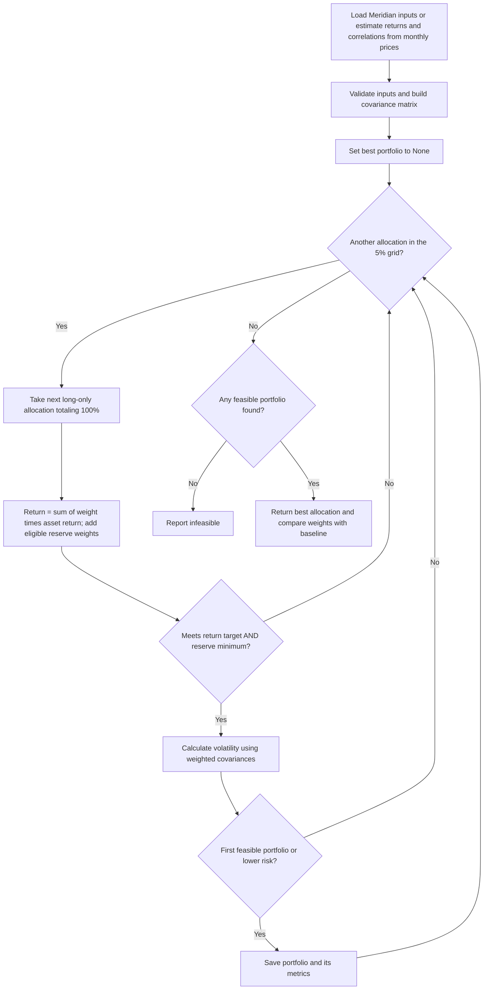

# Lab 15 — Portfolio Stability Decision

Built with AI help, a learning demonstration, not investment advice.

## Decision and method

The analysis asks whether the lowest-risk portfolio remains stable when an expected-return assumption changes. The engine searches every long-only allocation in 5-percentage-point increments, with weights totaling 100%. It rejects allocations below the return objective or reserve minimum and selects the feasible allocation with the lowest volatility. For four assets, the search evaluates 1,771 possible allocations. If none qualifies, it reports infeasibility.

Portfolio return is the sum of each asset's weight multiplied by its expected return. Portfolio variance includes every weighted covariance term; volatility is the square root of that variance. The dashboard imports these calculations from [portfolio.py](portfolio.py).

## Meridian results

The return objective is 6.5%, the reserve floor is 3%, and bills and the 10-year Treasury note qualify for reserves.

| Scenario | Bills | 10-year | IG bonds | Equity | Expected return | Volatility |
|---|---:|---:|---:|---:|---:|---:|
| Original optimized portfolio | 0% | 20% | 25% | 55% | 6.51% | 9.44% |
| Equity expected return reduced from 8% to 7% | 0% | 10% | 10% | 80% | 6.53% | 12.94% |
| IG–equity correlation raised from 0.25 to 0.50, original returns | 0% | 40% | 0% | 60% | 6.52% | 9.73% |

The one-point return stress produces a **25-percentage-point increase in equity**, the largest absolute weight change. The correlation connection test also matches the required result. Both correlation cells in the delivered source retain their original value of 0.25.

## Why the lowest-risk mix moved so far

The original portfolio held 55% equity. Reducing equity's expected return by one percentage point therefore reduces that portfolio's expected return by 0.55 percentage points: **6.51% becomes 5.96%**. It no longer meets the unchanged 6.5% objective.

Equity still has the highest expected return, so the optimizer increases its weight to reach the target. The selected portfolio's volatility rises from 9.44% to 12.94%. This is consistent with the optimization rule: it minimizes risk among portfolios that satisfy the constraints. When the original allocation becomes infeasible, the lowest-risk qualifying choice can be substantially riskier. The discrete 5% grid can also make allocation changes abrupt.

## Evidence needed before adoption

The 80% equity result is a model output, not sufficient evidence for implementation. Adoption would require a defensible basis for the return estimates, sensitivity checks across nearby assumptions and different sample windows, and downside analysis showing that the client could continue making distributions during losses. Liquidity, reserve eligibility, costs, and turnover would also need to satisfy the full mandate.

The observed sensitivity supports further evaluation before implementation. A numerical optimum does not establish suitability or reliable future performance. This is an analytical conclusion prepared with AI assistance; the student's personal adopt/pilot/reject decision has not been recorded.

## Project 2: Cedar estimation-window comparison

The existing mandate targets **CPI + 3% annually after costs over rolling five-year periods**. It requires a $600,000 reserve on a $20 million portfolio, or 3%. The existing price file contains BIL, IEF, LQD, and VT. BIL alone is treated as reserve eligible under the documented course proxy assumption.

The following calculation uses an explicitly illustrative **5.5% nominal hurdle**, combining the prior lab's estimated 2.5% CPI with Cedar's 3% target. Cedar-specific CPI and additional costs have not been confirmed, so these results do not certify satisfaction of the full after-cost mandate.

| Estimation window | BIL | IEF | LQD | VT | Return estimate | Volatility estimate |
|---|---:|---:|---:|---:|---:|---:|
| All 60 returns: Oct 2021–Sep 2026 | 75% | 0% | 0% | 25% | 5.67% | 3.83% |
| Last 36 returns: Oct 2023–Sep 2026 | 90% | 0% | 0% | 10% | 5.95% | 1.21% |

The largest absolute weight change is **15 percentage points**. The shorter window estimates higher BIL and VT returns, allowing the same hurdle to be met with less equity. This demonstrates estimation risk: changing the historical sample changes the selected allocation without changing the objective. It does not establish that the shorter-window allocation will perform better.

Monthly adjusted-close returns are annualized using mean times 12 and sample standard deviation times the square root of 12. Correlations use the same observations. Historical estimates are not forecasts. All four source series were downloaded from Yahoo Finance on **2026-10-20**; exact URLs and UTC timestamps remain in [download_metadata.json](sources/download_metadata.json).

VOO, SPY, QQQ, VTI, and SMH were subsequently named in the class discussion. They have not replaced the existing data, and no results for those five ETFs are claimed here. Current holdings and trading records are also absent, so annual turnover compliance has not been established.

## Mermaid flowchart and explanation

The chart expresses the reasoning in order: establish assumptions, test feasibility, compare risk, then inspect allocation stability. The feasibility diamond explains the Meridian result: after the return stress, the original allocation fails the target and is skipped. The final weight comparison exposes the 25-point change. Deciding whether to trust and adopt the output requires judgment beyond the search itself. The [full report](Lab15_Portfolio_Stability.md#portfoliopy-mermaid-flowcharts) also diagrams the original command-line program.

## Verification and supporting files

All seven Lab 15 automated test groups and the original Lab 14 verification suite passed. Tests reproduce all three Meridian scenarios, the 25-point change, original printed output, CSV estimates, reserve filtering, infeasibility, and dashboard controls. The running Streamlit server returned HTTP 200. Browser visual inspection and a real file-picker upload were not verified; CSV integration was tested with file bytes supplied at the widget boundary.

The submission includes [app.py](app.py), [portfolio.py](portfolio.py), [prices.csv](prices.csv), [requirements.txt](requirements.txt), [test evidence](verification.txt), [Project 2 results](project2_results.json), and the [detailed report](Lab15_Portfolio_Stability.md).

## Personal activity record

Actual partner name/challenge and the student's response have not been provided. The student's personal adopt/pilot/reject decision and reflection have not been recorded. The technical discussion above does not represent an independently completed partner exercise or a personal reflection.
