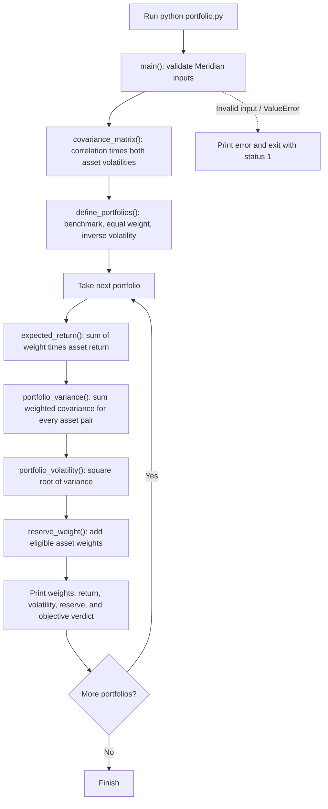
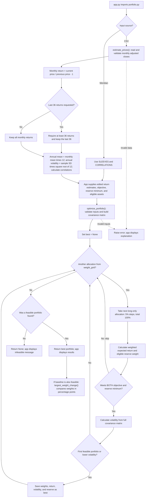

# Lab 15 — Portfolio Stability Decision

Built with AI help, a learning demonstration, not investment advice.

## Objective and decision question

Find the lowest-volatility long-only portfolio that meets the return objective and reserve minimum on a 5-percentage-point allocation grid. How stable is that decision when an expected return, a correlation, or the historical estimation window changes?

The engine reuses the Lab 14 expected-return, covariance, volatility, and reserve functions. No required answer is hardcoded into the engine or dashboard. Known answers appear only as assertions in tests and as results in this report.

## Original program and repair

The first execution of `../Lab14/portfolio.py` failed: `Correlation [3,4] must be between -1 and 1; got 1.3.` Both symmetric IG–equity cells had been left at 1.30. The Lab 14 report records 0.25 as the intended normal value. Both cells were restored in Lab 14 and the Lab 15 continuation. No unrelated files were deleted.

`portfolio.py` preserves every original output line. Its original portfolios remain:

| Lab 14 portfolio | Bills / 10-year / IG / equity (%) | Expected return | Volatility | Eligible reserve |
|---|---|---:|---:|---:|
| Policy benchmark | 0 / 0 / 40 / 60 | 6.80% | 10.46% | 0.0% |
| Equal weight | 25 / 25 / 25 / 25 | 5.20% | 5.21% | 50.0% |
| Inverse volatility | 84.3 / 6.0 / 7.0 / 2.6 | 3.77% | 1.05% | 90.3% |

Rounded inverse-volatility weights total 99.9%; full-precision weights total 100%. The policy benchmark is distinct from the **optimized Meridian baseline** used for Lab 15 stability comparisons.

## Optimization and estimates

For weights w, annual expected returns mu, volatilities sigma, and correlations rho:

- Expected return = sum(w_i × mu_i).
- Covariance(i,j) = rho(i,j) × sigma_i × sigma_j.
- Portfolio variance = sum over i and j of w_i × w_j × Covariance(i,j).
- Portfolio volatility = square root of portfolio variance.
- Reserve weight = sum of weights of the selected eligible assets.

The search enumerates integer compositions of 20 units, each representing 5%. It therefore considers every long-only allocation totaling 100%, including zero weights. Four assets produce 1,771 candidates. It filters using full precision and picks the lowest volatility among qualifying candidates. Exact volatility ties retain the first candidate in deterministic enumeration order. A `None` return explicitly means infeasible. A 3% reserve floor becomes at least 5% on this grid. This is a grid optimum, not a continuous-weight optimum.

CSV input requires `Date` plus 1–6 adjusted-close asset columns. Dates are sorted; duplicate months, missing months, missing/nonfinite/nonpositive prices, and constant-return series are rejected. The app cannot verify from a generic upload whether a price column is truly adjusted close; that is the uploader's data responsibility.

Monthly return = adjusted_close_t / adjusted_close_(t−1) − 1. Annual expected-return **estimate** = monthly arithmetic mean × 12. Annual volatility estimate = monthly sample standard deviation (`ddof=1`) × sqrt(12). Correlations use the same monthly returns. Last-36 mode selects 36 returns after calculating returns, requiring at least 37 prices. These are historical estimates, not forecasts; square-root annualization assumes temporal variance scales appropriately and does not model serial correlation. This arithmetic return calculation is not CAGR.

## Meridian verification

Annual course inputs: bills 3.5% return / 0.5% volatility; 10-year 4.3% / 7.0%; IG 5.0% / 6.0%; equity 8.0% / 16.0%. The objective is 6.5%; reserve minimum is 3%; bills and the 10-year note qualify. Original correlations are preserved in `portfolio.py` and the source Lab 14 report.

| Scenario | Bills | 10-year | IG | Equity | Expected return | Volatility | Reserve |
|---|---:|---:|---:|---:|---:|---:|---:|
| Optimized original baseline | 0% | 20% | 25% | 55% | 6.51% | 9.44% | 20% |
| Equity return changed from 8% to 7% | 0% | 10% | 10% | 80% | 6.53% | 12.94% | 10% |
| IG–equity correlation changed to 0.50, original returns | 0% | 40% | 0% | 60% | 6.52% | 9.73% | 40% |

All three are computed results. The one-point stress changes weights by 0, −10, −15, and +25 percentage points. The largest absolute change is **25 percentage points**. The stressed portfolio's expected return is evaluated using 7% equity; baseline metrics retain the original 8% estimate.

The connection test writes a temporary copy of `portfolio.py` with both symmetric correlations at 0.50, runs the actual dashboard in a fresh interpreter, and verifies weights and metrics. The delivered file remains at 0.25 in both cells; a preservation assertion verifies this. Changing only one cell is invalid because covariance must be symmetric.

## Actual Project 2 mandate — Cedar Scholarship Foundation

Source: [Project2_Mandate_Source.md](Project2_Mandate_Source.md), section H (copied unchanged from Lab 13). Client assets: $20 million; ten-year horizon; quarterly scholarship payments: $150,000. The actual return objective is **CPI + 3% annually after costs over rolling five-year periods**.

Hard constraints in that source:

- Approved cash, U.S. Treasury, diversified global equity, and diversified U.S. investment-grade bond exposures; fully invested, long-only, no borrowing or direct derivatives.
- At least $600,000 in cash or Treasury bills maturing within twelve months, or **3%** at inception.
- At least 95% redeemable within five business days.
- At most 5% direct nonexempt single-company exposure; cash, Treasuries, and diversified funds are exempt.
- Annual rebalancing; one-way annual turnover no more than 20% without committee approval, measured using the smaller of purchases and sales divided by average portfolio market value.

Selected funds are **BIL, IEF, LQD, and VT**, as recorded in the Lab 14 fund-universe section. Only BIL is eligible for Cedar reserves under the documented course proxy assumption. BIL ETF shares do not themselves mature; using the fund as a short-term Treasury reserve requires that assumption. IEF is not Cedar reserve eligible. The approved-universe/liquidity/exemption mapping follows the prior lab's fund treatment; the search explicitly enforces long-only, 100% total, the return hurdle, and the 3% reserve floor. It does not certify liquidation under stress, a rolling-five-year outcome, or turnover compliance.

### Missing inputs and scope of the numerical illustration

The mandate does not provide a Cedar-specific numerical CPI assumption, an additional cost estimate, current holdings, historical trades, or average portfolio market value. Do not treat the illustration below as confirmed full-mandate compliance. **Provide or confirm:**

1. Cedar CPI assumption or the nominal hurdle the instructor wants used.
2. Applicable cost estimate/basis for translating the after-cost objective into a hurdle for historical adjusted-price returns. Fund expenses embedded in NAV should not be counted twice.
3. Current holdings, purchases/sales, and average market value if turnover compliance is required; alternatively confirm that this is inception allocation.
4. Confirmation of BIL as the permitted reserve proxy.

For a transparent calculation using available inputs, the dashboard and this report use the prior lab's **2.5% estimated CPI + Cedar's 3% = 5.5% illustrative nominal hurdle**, without inventing an extra cost deduction. It is never lowered to force feasibility. The actual objective remains CPI + 3% after costs. No all-month/36-month answer for a fully specified net mandate is claimed until those inputs are supplied.

### All-month versus last-36 results at the illustrative 5.5% hurdle

Both searches enforce the same 3% BIL reserve minimum. The original CSV has 61 monthly prices (September 2021–September 2026).

| Window | Return observations | BIL | IEF | LQD | VT | Expected-return estimate | Volatility estimate | Reserve |
|---|---:|---:|---:|---:|---:|---:|---:|---:|
| All months: Oct 2021–Sep 2026 | 60 | 75% | 0% | 0% | 25% | 5.67% | 3.83% | 75% |
| Last 36: Oct 2023–Sep 2026 | 36 | 90% | 0% | 0% | 10% | 5.95% | 1.21% | 90% |

Largest absolute weight change = max(|90−75|, |0−0|, |0−0|, |10−25|) = **15 percentage points**. Results retain full precision in `project2_results.json`. The hypothetical move is 15% one-way turnover if portfolio value is unchanged and there are no other trades; this does not establish compliance with Cedar's actual annual turnover definition without trading records and average market value.

| Asset | All-month annual mean estimate | Last-36 annual mean estimate | All-month volatility | Last-36 volatility |
|---|---:|---:|---:|---:|
| BIL | 3.59% | 4.37% | 0.51% | 0.21% |
| IEF | −1.79% | 3.07% | 7.65% | 6.66% |
| LQD | −0.81% | 4.84% | 9.79% | 7.82% |
| VT | 11.90% | 20.25% | 14.92% | 11.71% |

### Data sources and original download dates

These are existing data, not newly downloaded or independently reverified current market data. Each original JSON response and exact chart request URL is retained in `sources/`. The selected field was `indicators.adjclose[0].adjclose`, interval `1mo`, 61 observations per ticker. October 2026 was excluded as incomplete. Calendar month-end labels do not imply a trade occurred on a weekend.

| Ticker | Recorded source | Original UTC download timestamp |
|---|---|---|
| BIL | Yahoo Finance chart endpoint; `sources/BIL_monthly.json` | 2026-10-20T20:39:35.856159+00:00 |
| IEF | Yahoo Finance chart endpoint; `sources/IEF_monthly.json` | 2026-10-20T20:39:36.014216+00:00 |
| LQD | Yahoo Finance chart endpoint; `sources/LQD_monthly.json` | 2026-10-20T20:39:36.178430+00:00 |
| VT | Yahoo Finance chart endpoint; `sources/VT_monthly.json` | 2026-10-20T20:39:36.397830+00:00 |

Exact URLs and source fields: [download_metadata.json](sources/download_metadata.json). The copied CSV retains all original values. Provider-adjusted historical prices can later be revised.

## Estimation risk and allocation instability

The 36-month window estimates higher BIL and VT returns and lower volatilities, so the optimizer can meet the same hurdle with less equity. The 15-point allocation change reflects sensitivity to the sample used to estimate means and covariances. It does not show that the newer allocation is more accurate or safer out of sample. The windows overlap, are not independent experiments, and neither is an out-of-sample performance test.

In Meridian, cutting equity's return estimate reduces the original portfolio's expected return from 6.51% to 5.96%. That portfolio becomes infeasible at the unchanged 6.5% hurdle. Equity still has the highest return estimate, so the optimizer requires more equity to restore feasibility, even though this raises risk. Constraints, small margins above the target, and the discrete grid can cause abrupt changes in the selected portfolio. The larger IG–equity correlation also weakens their diversification benefit, leading the search to replace IG with Treasuries. None of these changes guarantees realized performance.

## Portfolio.py Mermaid flowcharts

The first diagram shows what happens when you run `python portfolio.py`. The second shows the functions imported and called by `app.py`; importing the module does not run `main()`.

Partner explanation: **Multiply each weight by its asset return and add them. Use covariance to calculate risk. Try every 5% allocation, skip those that fail the requirements, and keep the feasible one with the lowest volatility.** Historical estimates are not forecasts.

## Explain the search in class, line by line

Read `optimize_portfolio()` alongside this explanation:

1. `def optimize_portfolio(...)`: receive the asset return/volatility pairs, correlations, objective, reserve floor, and eligible names; rates use decimals.
2. `import numpy as np`: load the matrix-validation tool.
3. `validate_inputs(...)`: reject malformed, nonfinite, asymmetric, or out-of-range inputs.
4. The asset-count check limits the exhaustive search to one through six assets.
5. The reserve-minimum check rejects values outside 0–100% or nonfinite values.
6. The eligible-name check prevents misspelled or nonexistent reserve assets.
7. `eigvalsh(...)`: reject a correlation matrix that cannot represent valid nonnegative variance (allow tiny numerical error).
8. `covariance_matrix(...)`: reuse Lab 14 to convert correlations and asset volatility into covariance.
9. `best = None`: no feasible candidate has been found yet.
10. `for weights in weight_grid(...)`: visit each unique allocation on the complete 5% grid.
11. `expected_return(...)`: reuse Lab 14 to calculate the candidate's weighted expected return.
12. `reserve_weight(...)`: reuse Lab 14 to total its eligible reserve weights.
13. The `if` condition checks whether either requirement fails, using a tiny tolerance only for floating-point arithmetic.
14. `continue`: skip a failing candidate without comparing its risk.
15. `portfolio_volatility(...)`: reuse the complete covariance-based Lab 14 risk calculation.
16. The next `if` accepts the first feasible candidate or a candidate with lower volatility.
17. The `best` dictionary saves the weights and all three displayed metrics together.
18. `return best`: return the least-risk feasible candidate, or `None` if every candidate failed.

`weight_grid()` supplies those weights recursively: the final asset receives all remaining units; otherwise the loop assigns 0 through the remaining units to the current asset, recursively allocates the rest, and concatenates the current weight with the remaining weights. Starting at 20 units guarantees a total of 100% without rounding adjustments.

## Verification evidence and limitations

Run `python verify_submission.py` to reproduce seven automated test groups and the JSON results. Tests cover preserved original stdout, all three Meridian known answers, the 25-point comparison, complete four-asset grid enumeration, input validation, independent historical-estimate checks, malformed CSV rejection, dashboard return edits, reserve eligibility, infeasible objectives, both windows, CSV integration, and source-file correlation changes.

The Streamlit server was launched using `python -m streamlit run app.py --server.headless true --server.port 8515 --browser.gatherUsageStats false`. AppTest executes the dashboard. Its uploader lacks a setter, so tests inject an uploaded-file-compatible byte stream at the widget boundary and exercise the actual parsing and optimization paths. Browser file-picker interaction and visual layout inspection were not completed: the in-app browser was unavailable and browser discovery timed out. Do not represent those as passed. Initial test-harness failures were corrected before the successful rerun; see `verification.txt` for final results.

The running server's health endpoint returned HTTP 200 (`ok`); see `server_health.txt`. The original Lab 14 verification suite also passed after repair. Git was unavailable on the session PATH; no commit, push, or remote configuration was performed.

#